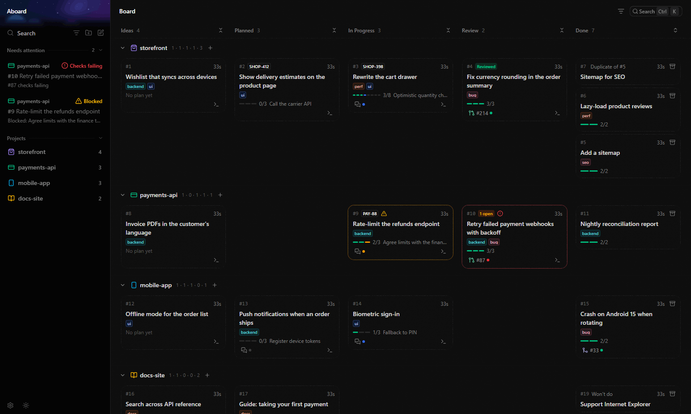

<p align="center">
  
</p>

<h1 align="center">Aboard</h1>

<p align="center">
  <strong>Mission control for your coding agents.</strong><br>
  A local kanban board where agents log ideas, write plans and report progress over MCP,<br>
  so you can run dozens of streams of work at once without losing track of any of them.
</p>

<p align="center">
  
  
  
  
  
  
</p>

<br>

<p align="center">
  
</p>

<br>

## Why

Coding agents made it cheap to start work. Keeping track of it is the hard part: five repos, a dozen
agent threads, PRs waiting on checks, ideas you had halfway through something else. All of that ends
up living in your head.

Aboard moves it onto a board, and the agents keep the board up to date themselves:

- **One glance, every project.** A swimlane per repo, columns from **Backlog** to **Done**. You can see
  what's moving, what's stuck and what's waiting on you.
- **Agents do the bookkeeping.** Over MCP they capture ideas, write a plan before they start, tick off
  steps as they go and leave a handover note when they stop. You don't have to update anything.
- **Pick up anything in seconds.** Every task shows its plan, the step it's on, its PRs, ticket and
  agent thread. Resume it yourself, or hand it to a fresh agent with one click.
- **Problems come to you.** Failing checks, requested changes and blocked steps collect under
  **Needs attention**, so you don't have to go looking.
- **Ideas don't get lost.** Anything worth doing later goes into the Backlog in one call, and the agent
  carries on with what it was doing.

Everything runs on your machine: a local server and a SQLite file, with no account and no cloud.

## Install

Download the desktop app from the [latest release](https://github.com/AlexSandilands/aboard/releases/latest):

| System               | Get                                                                                  |
| -------------------- | ------------------------------------------------------------------------------------ |
| Windows              | `Aboard-Setup-<version>.exe`. It installs for your user only, no admin rights needed |
| Arch Linux           | `paru -S aboard-bin` (or any AUR helper)                                             |
| Debian, Ubuntu, Mint | `aboard_<version>_amd64.deb`: `sudo apt install ./aboard_<version>_amd64.deb`        |
| Fedora, openSUSE     | `aboard-<version>.x86_64.rpm`: `sudo dnf install ./aboard-<version>.x86_64.rpm`      |
| Any other Linux      | `Aboard-<version>-x86_64.AppImage`: `chmod +x` it and run it                         |

The Windows installer isn't code-signed yet, so SmartScreen warns the first time you run it: **More info → Run
anyway**.

## Run from source

You need [Node 24+](https://nodejs.org) and [pnpm](https://pnpm.io).

```sh
git clone <repository-url> aboard
cd aboard
pnpm install
```

Then pick one:

```sh
pnpm start              # in the browser: http://127.0.0.1:4317
pnpm desktop:package    # the Windows app: apps/desktop/release/Aboard-Setup-<version>.exe
```

The desktop app keeps the board running in the tray, so agents can reach it with no terminal open.

## Connect an agent

Add the MCP server once for your user (Claude Code shown; [other agents](docs/guide/connect-agents.md)):

```sh
claude mcp add --scope user --transport http aboard http://127.0.0.1:4317/mcp
```

Then teach it the workflow: in **Settings → Integrations**, turn on **Board skills** for Claude Code, Copilot or
Codex. The board installs [`skills/aboard`](skills/aboard) (and [`skills/aboard-automations`](skills/aboard-automations),
for writing custom automations) into that agent's skills folder and keeps them updated
with the app, without overwriting a copy you edited. Other agents: copy the
[`AGENTS-snippet.md`](skills/aboard/AGENTS-snippet.md) into your `AGENTS.md` (Settings has a Copy button that
tells you when it changes). Agents identify the project by their working directory, so there's nothing to set up
per repo.

## Learn more

| Guide                                                  | What's in it                                                           |
| ------------------------------------------------------ | ---------------------------------------------------------------------- |
| [Using the board](docs/guide/using-the-board.md)       | Plans, closing and deleting tasks, links, labels, layout, shortcuts    |
| [Settings](docs/guide/settings.md)                     | The settings page: its groups, sections and shortcuts                  |
| [Templates](docs/guide/templates.md)                   | Bug, Spike, Feature and your own starting points for new tasks         |
| [Recurring tasks](docs/guide/recurring-tasks.md)       | Tasks made from a template on a schedule                               |
| [Digest of what changed](docs/guide/digest.md)         | A daily summary of the board, plain or written by an agent             |
| [Custom automations](docs/guide/custom-automations.md) | Your own Autopilot triggers and actions: an agent or a command         |
| [Importing issues](docs/guide/importing-issues.md)     | Create a task from a ticket or GitHub issue URL                        |
| [Connecting agents](docs/guide/connect-agents.md)      | MCP setup for Claude Code, Codex, Copilot and VS Code                  |
| [Local review](docs/guide/local-review.md)             | Have agents' work reviewed on the board before they open a PR          |
| [Autopilot](docs/guide/autopilot.md)                   | Let the board act on its own: switch automations on, set limits, pause |
| [T3 Code](docs/guide/t3-code.md)                       | Thread links, live thread status, starting threads from a task         |
| [Configuration](docs/guide/configuration.md)           | Data folder, ports, access token, the desktop app's tray               |
| [Notifications](docs/guide/notifications.md)           | The inbox, pop-ups, the taskbar badge and what you're told about       |
| [Stats](docs/guide/stats.md)                           | Weekly charts of tasks, cycle time, reviews, PRs and Autopilot         |
| [Contributing](CONTRIBUTING.md)                        | Developing, checks, and where the design docs are                      |

<br>

<p align="center">
  <sub>UI components and design tokens adapted from <a href="https://github.com/pingdotgg/t3code">T3 Code</a> under the MIT license. See <a href="NOTICE">NOTICE</a>.</sub>
</p>
