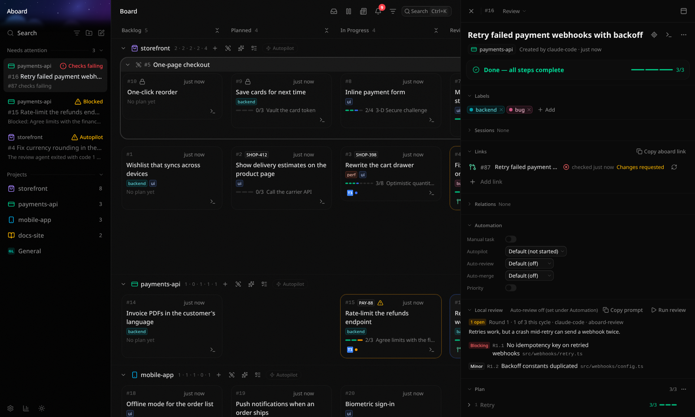

# Using the board

The board has one swimlane per project and five columns: **Backlog → Planned → In Progress → Review →
Done**. Agents move tasks along over MCP; you can do everything they can from the UI.

## Plans

A backlog task can be rough (an idea, a to-do, a Jira ticket), but it can't leave Backlog until it has a plan. A plan is a list of phases, each
with a few concrete steps. The task panel shows exactly which step a task is on, and the card shows its
progress.

## Closing, archiving and deleting

- **Closing without doing it:** a task that another task already delivered, a duplicate, or one you no
  longer want can be closed as **Done by #N**, **Duplicate of #N** or **Won't do** (task menu, or
  `close_task` over MCP). It moves to Done without needing a plan, and the other task lists it under
  "Also resolved". Moving it out of Done reopens it.
- **Archiving** clears a card off the board. It's for tidying up, not for resolving work. Archiving an epic
  (once none of its tasks is open) archives its Done tasks with it, and unarchiving the epic brings them back.
- **Deleting** removes an archived task for good, with its plan, links and activity (task menu, or
  `delete_task` over MCP). Archive first; active tasks can't be deleted.

## Links

A task can link to:

- **GitHub PRs**, on github.com or GitHub Enterprise, with their live state (checks, review, conflicts)
  and a **Merge** button once the task is in Review, through the account the `gh` CLI is signed in with.
- **GitHub issues**, with their state when imported (see [Importing issues](importing-issues.md)).
- **Jira issues.** Keys in a task's title are linked automatically.
- **T3 Code threads**, one click back to the conversation (see [T3 Code](t3-code.md)).
- **Claude Code and Copilot CLI sessions**, which agents link themselves. The card shows whether the
  session is still running, and **Open in terminal** resumes it in its folder (or forks it, for Claude
  Code, when it is still running). Choose the terminal in **Settings → Integrations → Terminal**; **Copy resume command**
  works anywhere.
- **Any URL.**

In the task panel, sessions (T3 threads, Claude Code and Copilot CLI sessions, Autopilot's runs) have a
**Sessions** section of their own, above **Links**, which holds everything else: PRs first, then issues, Jira keys
and other URLs. Like the other sections, each can be collapsed, moved or hidden from **Customize sections**. Past
three sessions, **Show N more** reveals the rest. When the task has one T3 thread, its Claude Code sessions are in
the thread's ⌄ menu instead of rows of their own.

Failing checks, requested changes and blocked steps show up under **Needs attention** in the sidebar.
Agents are told which Jira issue, T3 thread and session a task is still missing, so links tend to fill in on
their own.

## Labels

Tag tasks with the kind of work (`ui`, `backend`, `bug`) from the task panel, or let agents do it; they
are asked to suggest labels for tasks that have none. Filter the board by one or more labels. Each label
gets a colour you can change.

## Templates

Start a task from a template (Bug, Spike, Feature or your own) in New task, to pre-fill its description, labels and plan. See [Templates](templates.md).

## Blocking

A task can wait on others, in any project: open its panel, find **Relations** and **Add** a task under
**Blocked by** (or under **Blocks**, to make another task wait on this one). A blocked card shows a lock, and
hovering it names what it is waiting on. It is ready once every blocker is Done. Loops are refused.

Hover a card, or open one, to draw lines to the tasks it blocks (green) and is blocked by (red). Hold Shift to
draw the whole chain, with each step further away a little darker. Agents set blockers too and are told not to
start a blocked task.

## Suggested model

The agent that plans a task suggests a model tier (light, standard or deep) for implementing it. Say what
each tier means in **Settings → Tasks → Models**; copied prompts name it, and new T3 Code threads start on it.

The task panel's Details section shows the tier, the model you mapped to it and the planner's reason. Change
or clear the tier from the dropdown there; picking one drops the planner's reason.

## Autopilot flag

Each task has an **Autopilot** setting in the panel's Details section: Default, On or Off. Autopilot only
starts tasks you flag On, so Default never starts one. When Start planned tasks is switched on for a
project, agents that plan a task ask you whether to flag it, and only set it after you answer. They can
flag tasks but never change Autopilot's own settings.

## Handing a task to an agent

Every open task has a hand-off menu. **Copy prompt** copies a ready-to-paste prompt for any agent
(Claude Code, Copilot, …), with a planning variant for tasks that have no plan yet. With [T3 Code](t3-code.md) paired,
**New T3 Code thread…** starts a thread for the task directly.

When Claude Code or Copilot CLI is installed (on your PATH, or at the path set in **Settings → Integrations**),
**New Claude Code session…** and **New Copilot CLI session…** open the CLI in a terminal with the task's prompt
already typed in. The dialog lets you edit the prompt, switch to planning, pick a model (filled in from the task's
suggested tier, see **Session models** under each CLI in Settings) and choose where it runs: a new git worktree
from a branch you pick (the default), or the project's own folder. The board links the session to the task straight
away. On Windows Terminal, a task's sessions open as tabs of one window named after the task, and
opening a session that is still running brings that window back to the front. On Windows a prompt with a `%` in it,
or longer than about 8,000 characters, can't go on the command line: the session starts with a short pointer to the
task instead, and the full prompt is on your clipboard to paste.

## Your layout

Collapse a column (Done starts collapsed) or just one project's cell, and collapse, reorder or hide the
sections of the task panel. Your layout is saved per browser.

## Keyboard

| Key          | Action               |
| ------------ | -------------------- |
| `Ctrl/Cmd K` | Command palette      |
| `Ctrl/Cmd ,` | [Settings](settings.md) |
| `N`          | New task             |
| `Esc`        | Close the task panel, or leave Settings |
